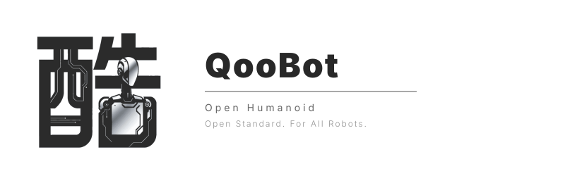
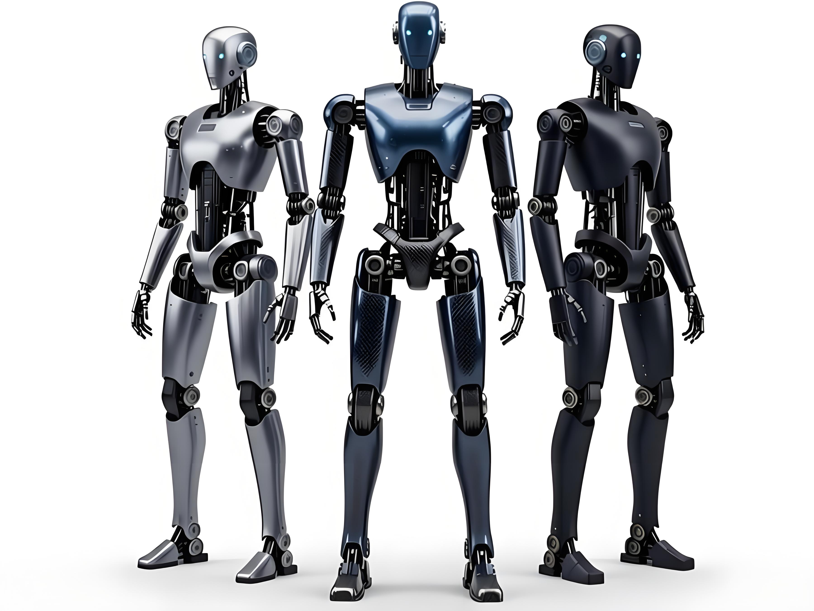
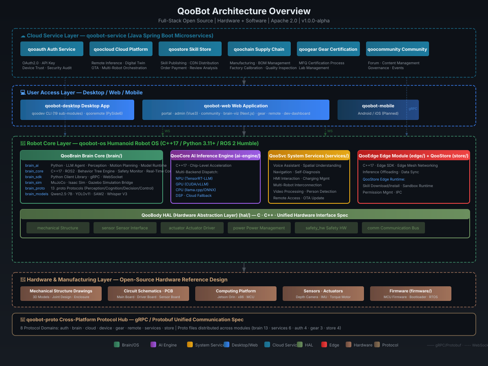

**全栈开源 · 硬件 + 软件**

从机械图纸、电路设计到操作系统与 AI 算法 —— 完全开源，自由制造。打造属于你自己的人形机器人。

  
  
  
  

  
  
  
  

> [English](./README.md) | 简体中文

---

## 🤖 QooBot —— 全栈开源人形机器人操作系统

> **为下一代物理 AI 构建通用操作系统** —— 以人形机器人为核心，覆盖工业、服务、家庭等全场景应用。

  

### 🏗 系统架构

  

### 🧩 平台总览

| 平台 | 定位 | 技术栈 |
|:--|------|--------|
| **[qoobot-os](https://github.com/qoobots/qoobot)** | 人形机器人操作系统 —— HAL 硬件抽象层、AI 引擎、大脑核心、系统服务、边缘模块、技能商店 | `C++17` `Python` `ROS2` `MuJoCo` |
| **[qoobot-web](https://github.com/qoobots/qoobot)** | Web 应用 —— 品牌门户、管理后台、社区、大脑 3D 数字孪生、远程操控、开发者面板 | `Vue 3` `React` `Next.js` `Three.js` `WebRTC` |
| **[qoobot-desktop](https://github.com/qoobots/qoobot)** | 桌面工具 —— 开发工具链（qoodev v1.7.0）、机器人远程监控控制台 | `Python 3.11+` `PySide6` |
| **[qoobot-service](https://github.com/qoobots/qoobot)** | 云端微服务 —— 认证授权、云平台、合规、技能商店、供应链、配件认证、社区 | `Java` `Spring Boot 3` `PostgreSQL` |
| **qoobot-mobile** | 移动端 App —— Android / iOS 原生 *（规划中）* | `Flutter` `Dart` |
| **[qoobot-proto](https://github.com/qoobots/qoobot)** | 跨平台协议 —— gRPC / Protobuf，涵盖 8 大协议域 | `Protobuf` `gRPC` |

> 📂 **[浏览完整的 QooBot 项目 →](https://github.com/qoobots/qoobot)**

---

## 🧑‍💻 关于我

- 🔭 **当前在做：** QooBot 人形机器人操作系统 & QooERP 企业级 ERP 系统
- 🌱 **正在探索：** 多模态大模型、AI Agent 垂直行业落地、Web3 + 去中心化身份（DID）
- 👯 **期待合作：** AI 开源项目、企业级 SaaS 系统
- 💬 **可以聊：** Java 微服务、Spring Boot 3.x、AI Agent 开发、企业级系统架构设计
- 📫 **联系我：** [hello@qoobot.com](mailto:hello@qoobot.com)
- ⚡ **28+ 开源项目**，覆盖 AI、ERP、云计算、电商、Web3、机器人等多个领域

---

## 📦 项目清单

### 🤖 AI 与大模型

| 项目 | 简介 |
|:--|-------------|
| [qoocode](https://github.com/qoobots/qoocode) | Claude Code 风格的 AI 编程助手 CLI —— 63+ 斜杠命令、34+ 工具 |
| [aicoding](https://github.com/qoobots/aicoding) | 大模型智能代码生成工具，支持批量生成企业级项目 |
| [openagent](https://github.com/qoobots/openagent) | 覆盖 23 个垂直领域的 AI Agent 系统 —— LangChain4J + Spring AI |
| [openllm](https://github.com/qoobots/openllm) | 10 个垂直领域大模型微调项目（金融、医疗、法律、制造等） |
| [openlabeling](https://github.com/qoobots/openlabeling) | 大模型数据标注平台 |
| [qoowork](https://github.com/qoobots/qoowork) | AI 办公平台 —— 全场景桌面 AI 助手 + IDE 插件 |

### 🏢 企业级应用

| 项目 | 简介 |
|:--|-------------|
| [eva](https://github.com/qoobots/eva) | 企业级 AI 一体化管理平台 —— 身份权限、组织租户、AI 智能体、知识库 / RAG、低代码、内容中心、监控审计，共 47 个域 |
| [qooerp](https://github.com/qoobots/qooerp) | 下一代开源 ERP —— 100+ 业务模块，DDD + 微服务 |
| [openaccounting](https://github.com/qoobots/openaccounting) | 企业财务管理（总账、报表、预算、资产） |
| [opentax](https://github.com/qoobots/opentax) | 企业税务管理（开票、申报、风控、金税四期） |
| [openscm](https://github.com/qoobots/openscm) | 供应链管理（供应商、采购、库存、物流） |
| [openwarehouse](https://github.com/qoobots/openwarehouse) | 开源 WMS，四级仓库层级结构 |
| [openidaas](https://github.com/qoobots/openidaas) | 企业级 IDaaS 身份认证平台 —— OAuth2.1 + SAML 2.0 |
| [openadmin](https://github.com/qoobots/openadmin) | 现代化企业应用框架，完整的微服务解决方案 |

### ☁️ 平台与基础设施

| 项目 | 简介 |
|:--|-------------|
| [opencloud](https://github.com/qoobots/opencloud) | 企业级开源云平台 —— 虚拟机 + 容器双架构 |
| [openlowcode](https://github.com/qoobots/openlowcode) | JavaFX 桌面端低代码代码生成平台 |
| [solra](https://github.com/qoobots/solra) | 下一代去中心化虚拟世界（5G 空间社交） |
| [openclaw](https://github.com/qoobots/openclaw) | 个人 AI 助手，支持 25+ 消息渠道接入 |

### 🛒 电商 · 社交 · Web3

| 项目 | 简介 |
|:--|-------------|
| [openmall](https://github.com/qoobots/openmall) | 生产级 B2B2C 多商户电商平台 |
| [openim](https://github.com/qoobots/openim) | 微信式即时通讯应用（聊天、朋友圈、红包） |
| [openrecommend](https://github.com/qoobots/openrecommend) | 多内容智能推荐系统 |
| [openweb3](https://github.com/qoobots/openweb3) | Web3 应用场景与架构蓝图（20 大场景 + RWA / DePIN） |
| [openblog](https://github.com/qoobots/openblog) | QooBot 官方展示站（赛博朋克终端风格） |

---

  

### "Building enterprise-grade open source with AI, one commit at a time."

> 以 AI 构建企业级开源，一次提交，一步前行。

